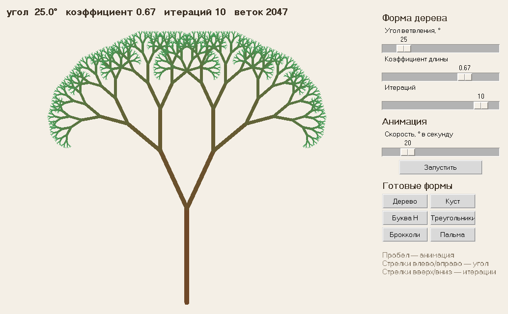
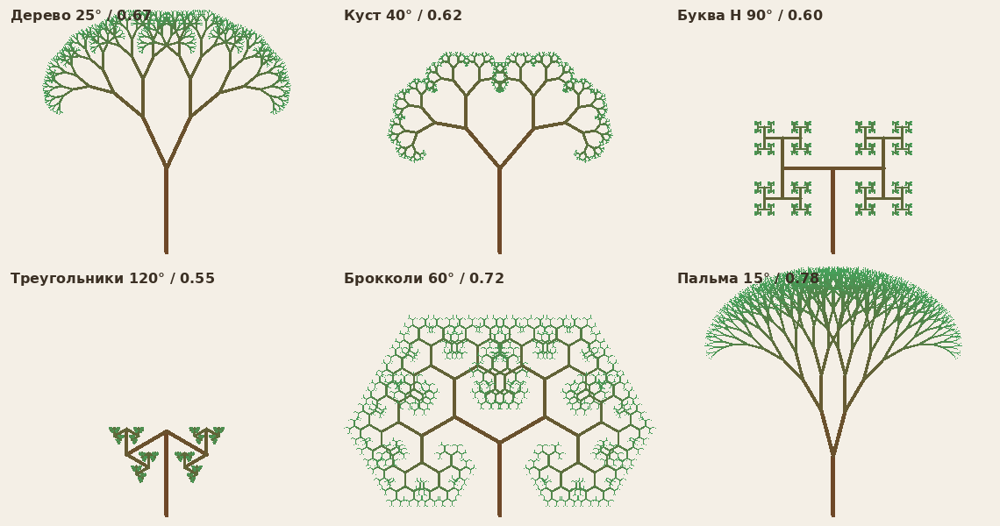
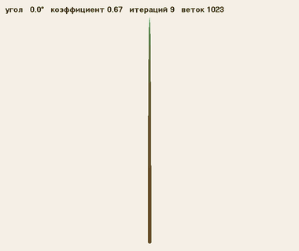

# Фрактальное дерево

**Автор:** Харламова Елизавета Романовна

**Группа:** ПИ25-1

**Дисциплина:** —

**Дата сдачи:** —

## Описание проекта

Программа рисует фрактальное дерево: из вертикального ствола вырастают две ветки покороче,
повёрнутые на заданный угол, из каждой из них — ещё по две, и так 10 итераций. Угол ветвления,
коэффициент уменьшения длины и число итераций меняются слайдерами, а анимация плавно
раскрывает и складывает дерево, изменяя угол.

Работа выполнена по заданию «Простой фрактал» из лабораторной работы №1 «Простая анимация».

## Функциональные возможности

### Основной функционал

- 🌳 Рекурсивное построение дерева: ствол снизу до центра экрана и 10 итераций ветвления
- 🎨 Цвет веток плавно меняется от коричневого ствола к зелёным концам, толщина уменьшается
- 📐 Автоматическое уменьшение ствола, если дерево не помещается в окно

### Дополнительный функционал

- 🧪 Эксперименты с углом и коэффициентом длины: слайдеры и 6 готовых форм (доп. задание 1)
- 🎚️ Угол ветвления регулируется слайдером от 0° до 180° (доп. задание 2)
- ▶️ Анимация: угол плавно меняется от 0° до 180° и обратно с регулируемой скоростью
- 🔢 Слайдер количества итераций (1–11)
- ⌨️ Управление с клавиатуры
- ✅ Модульные тесты модели

## Демонстрация работы программы

### Главное окно



### Готовые формы



### Анимация угла



## Требования к системе

- **Python:** 3.9 или выше
- **Операционная система:** Windows / macOS / Linux
- **Библиотеки:** только стандартная библиотека Python
  - `tkinter` (встроенная) — окно, холст, слайдеры, кнопки
  - `math`, `dataclasses`, `contextlib`, `time` — расчёты и служебные функции
  - `unittest` — тесты

## Установка и запуск

### 1. Клонирование репозитория

```bash
git clone https://github.com/lizabasya408-dota/fractal-tree.git
cd fractal-tree
```

### 2. Создание и активация виртуального окружения

Windows:

```bash
python -m venv venv
venv\Scripts\activate
```

macOS/Linux:

```bash
python3 -m venv venv
source venv/bin/activate
```

### 3. Установка зависимостей

```bash
pip install -r requirements.txt
```

Сторонних библиотек нет, команда оставлена для единообразия.

### 4. Запуск программы

```bash
python main.py
```

### 5. Управление

| Действие | Клавиша / элемент |
|---|---|
| Изменить угол ветвления | слайдер «Угол ветвления» или стрелки `←` `→` |
| Изменить коэффициент длины | слайдер «Коэффициент длины» |
| Изменить число итераций | слайдер «Итераций» или стрелки `↑` `↓` |
| Запустить / остановить анимацию | `Пробел` или кнопка «Запустить» |
| Скорость анимации | слайдер «Скорость» |
| Готовая форма | кнопки «Дерево», «Куст», «Буква H» и др. |

### 6. Запуск тестов

```bash
python -m unittest discover -s tests -t . -v
```

## Структура проекта

```text
fractal-tree/
├── .gitignore
├── README.md
├── requirements.txt
├── main.py                      # запуск программы
├── venv/                        # виртуальное окружение
├── screenshots/                 # картинки для README
├── src/
│   ├── __init__.py
│   ├── app.py                   # TreeApp: окно, клавиши, анимация
│   ├── config.py                # размеры, цвета, пределы, готовые формы
│   ├── models/
│   │   ├── __init__.py
│   │   └── tree.py              # Branch и FractalTree: рекурсивное построение
│   ├── renderers/
│   │   ├── __init__.py
│   │   └── canvas_renderer.py   # TreeRenderer: рисование веток на Canvas
│   └── widgets/
│       ├── __init__.py
│       └── panel.py             # SettingsPanel: слайдеры и кнопки
└── tests/
    ├── __init__.py
    └── test_tree.py             # тесты модели, цвета и толщины
```

**Почему так.** Код разделён на три независимые части:

- `models/` — только геометрия дерева, без tkinter, поэтому её удобно проверять тестами;
- `renderers/` — только рисование того, что посчитала модель;
- `widgets/` — только элементы управления, которые сообщают приложению о новых значениях;
- `app.py` соединяет эти части и управляет главным циклом.

## Как работает алгоритм

Функция `_grow` рисует одну ветку и вызывает сама себя для двух дочерних:

1. Конец ветки длины `L` под углом `θ` к горизонту: `x2 = x + L·cos θ`, `y2 = y − L·sin θ`
   (минус, потому что на экране ось Y направлена вниз).
2. Если сделано `depth` итераций, рекурсия останавливается.
3. Иначе из конца ветки растут две новые длиной `L · k` под углами `θ + α` и `θ − α`,
   где `α` — угол ветвления, `k` — коэффициент длины.

Ствол растёт вертикально вверх (`θ = 90°`). При 10 итерациях получается
`2¹¹ − 1 = 2047` веток.

Анимация сделана через `root.after()`: каждые 16 мс угол меняется на
`скорость × время кадра`, а линии на холсте переставляются через `canvas.coords`.

## Пример использования

```bash
python main.py
```

- Нажмите `Пробел`: угол пойдёт от 0° до 180° и обратно. При 0° дерево — вертикальная «палка», к 90° оно раскрывается в «букву H», а к 180° ветки снова складываются вдоль ствола.
- Нажмите «Буква H»: при угле 90° получается H-фрактал.
- Поставьте коэффициент 0.8 и угол 15°: получится пальма.
- Уменьшите число итераций до 3–4, чтобы увидеть, как строится дерево по шагам.
